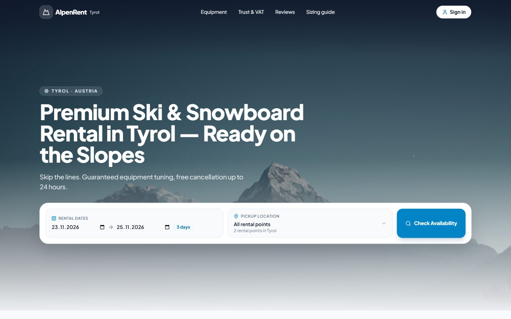
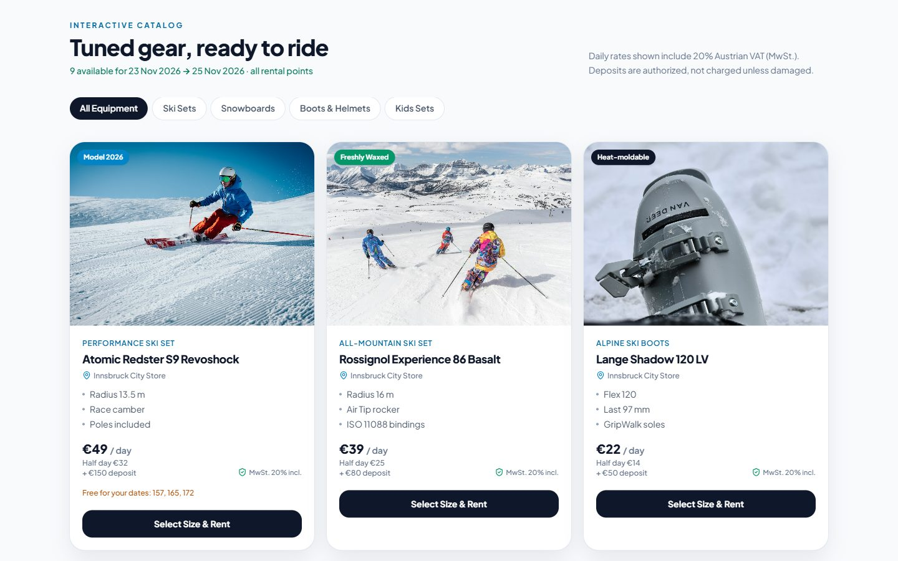
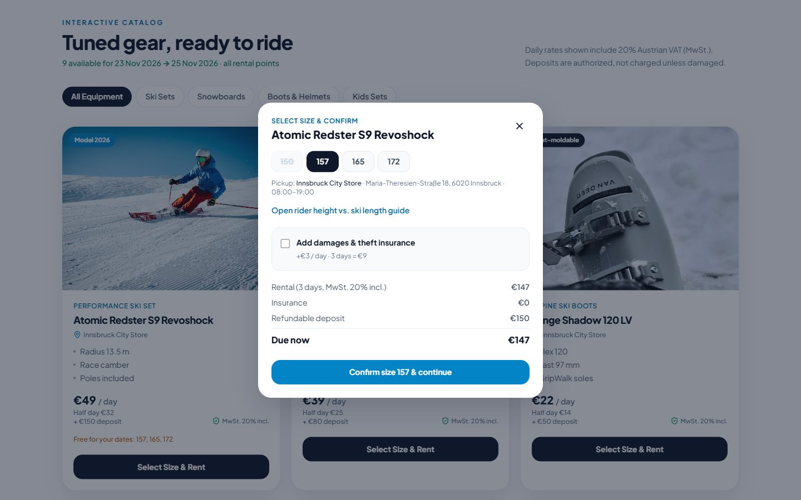
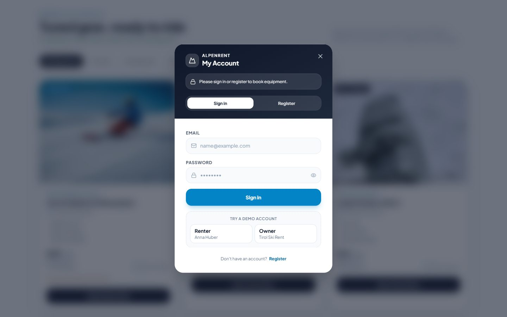
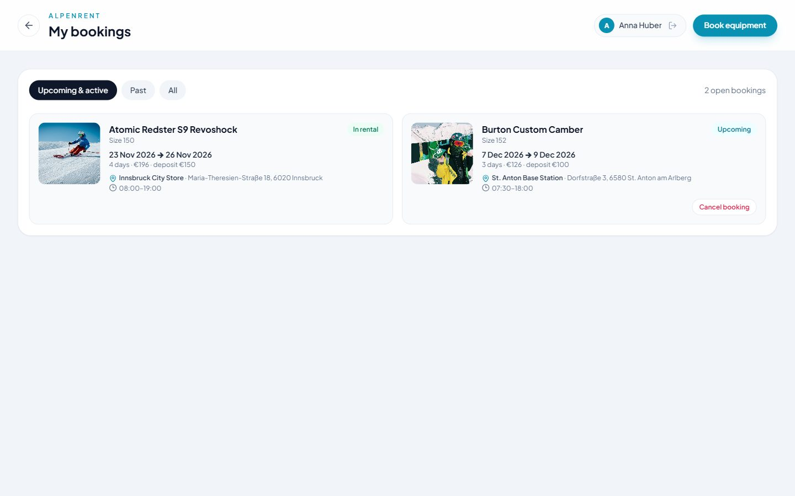
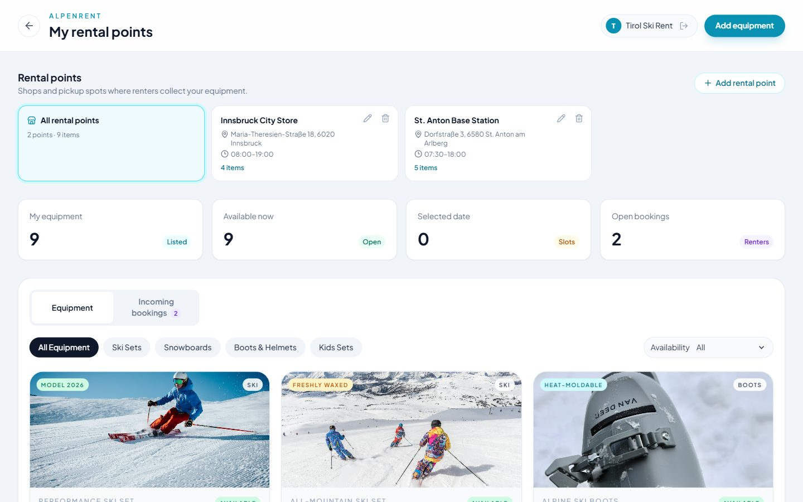

# Alpenrent

[](https://github.com/v-cheff/alpenrent/actions/workflows/ci.yml)

A ski and snowboard rental marketplace for the Austrian Alps, built as a portfolio project.
Renters search free equipment for their dates and book it. Rental point owners manage their
stores, equipment and incoming bookings.

**Stack:** Laravel 13 (PHP 8.4) REST API · PostgreSQL 17 · Vue 3 + Vite · Tailwind CSS · Docker Compose



## Screenshots

| Catalog with free sizes for the selected dates | Booking dialog: booked sizes are struck through |
| --- | --- |
|  |  |
| **Sign-in with one-click demo accounts** | **Renter: My bookings** |
|  |  |

**Owner: rental points, equipment, availability and incoming bookings**



## Quick start

Requirements: [Docker Desktop](https://www.docker.com/products/docker-desktop/) (or Docker
Engine with the Compose plugin) and free ports `5173`, `8000` and `5432`.

```sh
git clone https://github.com/v-cheff/alpenrent.git
cd alpenrent
docker compose up --build -d
```

That's all. On the first start the backend container creates `backend/.env`, generates the
app key, runs the migrations and seeds the demo data. The first build takes a few minutes;
the API is ready when `docker compose logs backend` shows `Server running`.

| What | URL |
| --- | --- |
| Web app | http://localhost:5173 |
| API | http://localhost:8000/v1 |

## Demo accounts

Both accounts use the password **`password`**. The sign-in dialog also has one-click
**Renter** / **Owner** buttons for them.

| Role | Email | Name |
| --- | --- | --- |
| Renter | `renter@example.com` | Anna Huber |
| Rental point owner | `owner@example.com` | Tirol Ski Rent |

The owner has two rental points with equipment at each:

- **Innsbruck City Store**, Maria-Theresien-Straße 18, Innsbruck, 08:00–19:00: two ski sets,
  ski boots, a kids' ski set.
- **St. Anton Base Station**, Dorfstraße 3, St. Anton am Arlberg, 07:30–18:00: all-mountain
  skis, two snowboards, a helmet with goggles, a kids' ski set.

All names, addresses and accounts are made up.

### Suggested walkthrough

1. Open the home page, pick dates and a pickup location, press **Check Availability**.
   The catalog shows only equipment with a free size for every day of that period.
2. Press **Select Size & Rent** on any item. You are asked to sign in: press the **Renter**
   demo button.
3. Choose a size (booked sizes are struck through), optionally a half day for one-day rentals,
   and confirm. The booking appears under **My bookings**, where it can be cancelled.
4. Search the same dates again: the size you booked is no longer offered.
5. Sign out and sign in as the **Owner** (`owner@example.com`). **My rental points** shows the two stores,
   the equipment, an availability calendar and the incoming booking from Anna Huber.
   Add a new item: it appears in the public catalog straight away.

New accounts can also be registered from the sign-in dialog, as a renter or an owner.

## Features

- **Two roles.** Each user is a renter or an owner, chosen at registration. Each role has its own
  account page, and the API enforces roles (`403` otherwise).
- **Availability search.** For a date range and pickup point, the API returns each item's
  free sizes, taking existing bookings and the owner's stock dates into account.
- **Booking rules**, enforced by the API, not only the UI:
  - rental days are inclusive: 1–4 December is 4 days, a single date is 1 day;
  - a half day (from 12:00) is offered only for a single date and only if the owner set a
    half-day rate;
  - the same size can't be booked twice for overlapping dates;
  - bookings can't start in the past.
- **Owner dashboard**: rental points, equipment with photo upload or image URL, an
  availability calendar (month/week), incoming bookings.
- **Token authentication** (bearer tokens) with a custom middleware.
- **Feature tests** for auth, roles, catalog, equipment, rental points and bookings, run by
  GitHub Actions together with the frontend and Docker builds.

## Useful commands

```sh
# Run the backend test suite (SQLite in memory, doesn't touch your data)
docker compose exec backend php artisan test

# Reset the database to the demo data (deletes everything else)
docker compose exec backend php artisan migrate:fresh --seed

# Follow the logs
docker compose logs -f backend

# Stop the app (data is kept); add -v to also delete the database volume
docker compose down
```

## API overview

All endpoints are under `/v1`. Protected endpoints take `Authorization: Bearer <token>`,
which `POST /v1/auth/login` and `POST /v1/auth/register` return.

| Access | Method | Path | Purpose |
| --- | --- | --- | --- |
| Public | GET | `/rental-points` | Rental points that have equipment |
| Public | GET | `/equipment?rentalPointId=&startDate=&endDate=` | Catalog; with dates every item has `availableSizes` |
| Public | GET | `/equipment/{id}` | One item |
| Renter | GET / POST | `/bookings` | Own bookings / create a booking |
| Renter | PUT / DELETE | `/bookings/{id}` | Change / cancel a booking |
| Owner | GET / POST | `/my/rental-points` | Own rental points / create one |
| Owner | PUT / DELETE | `/my/rental-points/{id}` | Update / delete (only without equipment) |
| Owner | GET | `/my/equipment` | Equipment at own rental points |
| Owner | GET | `/my/bookings` | Incoming bookings for own equipment |
| Owner | POST / PUT / DELETE | `/equipment[/{id}]` | Manage own equipment (`rentalPointId` required on create) |

A booking request looks like this:

```json
{ "equipmentId": "burton-custom-camber", "size": "152", "rentalType": "full_day",
  "startDate": "2027-01-10", "endDate": "2027-01-12" }
```

## Project structure

```text
backend/                  Laravel API
  app/Http/Controllers/   Auth, equipment, rental points, bookings
  app/Models/             Domain rules: availability, rental days, totals
  database/seeders/       Demo accounts and equipment
  docker/entrypoint.sh    First-start setup (env, key, migrations, seed)
  tests/Feature/          API tests
frontend/                 Vue 3 SPA
  src/components/         Home page: hero search, catalog, booking dialog
  src/my-bookings/        Renter account page
  src/my-equipment/       Owner account page
  src/composables/        Shared state: auth, booking
docs/screenshots/         Images used in this README
.github/workflows/ci.yml  Tests, frontend build, Docker build
docker-compose.yml        backend, frontend (Vite dev server), postgres
```

## Configuration

Defaults work out of the box. To change them, copy `.env.example` to `.env` in the project root:

| Variable | Default | Purpose |
| --- | --- | --- |
| `DB_DATABASE`, `DB_USERNAME`, `DB_PASSWORD` | `alpenrent` | PostgreSQL database and credentials |
| `DB_FORWARD_PORT` | `5432` | Host port for DB clients; change it if PostgreSQL already runs on your machine |

The frontend reads its settings from `frontend/.env`:

| Variable | Default | Purpose |
| --- | --- | --- |
| `VITE_API_URL` | `http://localhost:8000/v1` | API address |
| `VITE_SHOW_DEMO_ACCOUNTS` | not set (shown) | Set to `false` to hide the demo buttons in the sign-in dialog |

The backend allows CORS from `http://localhost:5173`.

Uploaded equipment photos are stored in `backend/storage/app/public/equipment` and served
from `/storage/equipment/...` (JPG, PNG or WEBP up to 5 MB, or an image URL instead).

## Troubleshooting

- **Port already in use.** Stop the program using it, or change `DB_FORWARD_PORT` for PostgreSQL.
  The ports `8000` and `5173` are also set in `frontend/.env` and `backend/config/cors.php`.
- **Empty catalog after changing the database settings.** The demo data is seeded only into an
  empty database; run `docker compose exec backend php artisan migrate:fresh --seed`.
- **Containers fail with `read-only file system`.** Docker ran out of disk space. Free some
  space, restart Docker Desktop and run `docker compose up -d` again.

## Credits

Equipment and background photos are from [Unsplash](https://unsplash.com) and used under the
[Unsplash License](https://unsplash.com/license). They are stored in the repository
(`backend/public/images`, `frontend/public/images`), so the demo works without external links.
